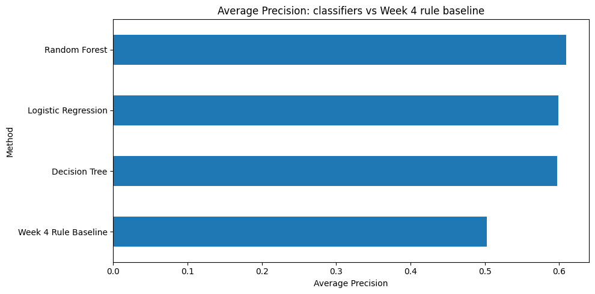
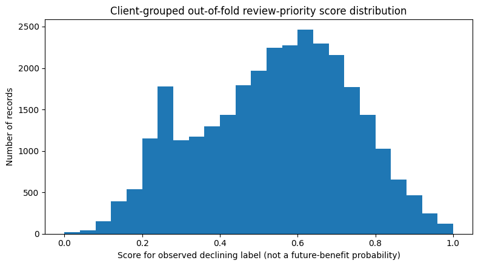
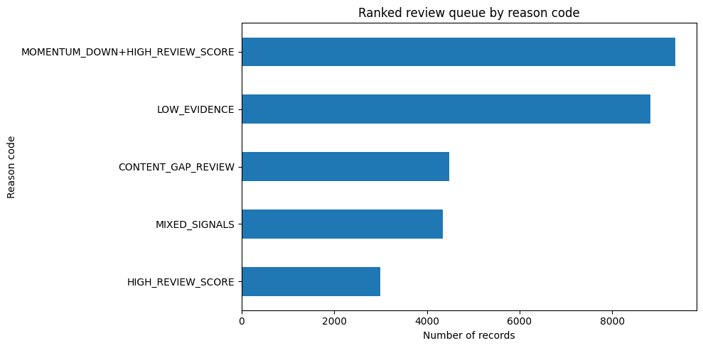

# Intelligent Content Refresh Prioritization: Ranking Content Records for Human Review

**Machine Learning Capstone — Refresh / Content Opportunity Scoring**  
**Author:** Vidit Palarpwar  
**Repository:** [FlyRank internship repository](https://github.com/Viditp25/flyrank-intern-)  
**Notebook:** [`work/notebooks/capstone.ipynb`](https://github.com/Viditp25/flyrank-intern-/blob/main/work/notebooks/capstone.ipynb)

## Abstract

Content teams need a defensible way to decide which pages or content records should be reviewed first when editorial capacity is limited. This project evaluates whether historical performance signals and content metadata can rank anonymized records associated with an observed declining trend more effectively than a rule-based baseline. Using 30,000 rows from the anonymized FlyRank ML Internship starter dataset, the workflow defines a proxy target from `trend_direction == "down"`, excludes label-derived fields and selected overlapping outcome-window measures, and compares Logistic Regression, Decision Tree, and Random Forest against the Week 4 rule baseline on a client-grouped holdout. In this executed run, Random Forest has the highest Average Precision among the classifiers (0.6096) and ROC-AUC (0.6581), while Decision Tree and Logistic Regression lead at different top-K review capacities. The output is a ranked, human-reviewed prioritization queue; these results do not prove future decline, causal refresh impact, or how Google's ranking algorithm works.

## 1. Introduction and problem statement

Content teams often have more content records to investigate than they can review in one cycle. A prioritization system can help allocate review effort consistently, provided that its scores are interpreted as decision support rather than automatic editorial instructions.

**Research question:** Can historical content-performance signals and available content metadata rank anonymized content records labelled as declining more effectively than a simple rule-based baseline?

The decision supported by this work is which records should be examined first. The target used here is an observed category in the supplied data. It is not a future-window label, so the study does not claim to predict which records will decline in a later period.

## 2. Data and public-safe handling

The executed capstone notebook reports **30,000 rows and 44 source columns** from the approved anonymized starter dataset referenced by the project repository. The observed `trend_direction` distribution is:

| Observed label | Rows |
|---|---:|
| `down` | 16,262 |
| `stable` | 5,962 |
| `up` | 4,388 |
| `new` | 2,236 |
| `flat` | 1,152 |
| **Total** | **30,000** |

The binary target is `1` when `trend_direction == "down"` and `0` for the other accepted categories. This yields 16,262 positive records and 13,738 negative records, an overall positive-label rate of **54.21%**.

### Historical-window reconstruction

The notebook reconstructs days 61–90 for impressions, clicks, and sessions by subtracting the latest 30-day and preceding 30-day values from the 90-day total. The executed audit reports 30,000 valid reconstructed rows for each metric, no missing source rows, and no negative reconstructed values.

This reconstruction assumes the source windows are aligned, non-overlapping, and consistently defined. Those assumptions should be checked against the dataset documentation before operational use.

### Privacy and exclusions

This public paper intentionally omits client names, content identifiers, domains, URLs, private queries, credentials, and raw row-level exports. The model excludes identifiers, the target, `trend_direction`, `trend_pct`, and selected full-period/latest-window measures that overlap the outcome window. Row-level review-queue output is not included in this paper and should not be committed to a public repository.

## 3. Methodology

### Features

The executed notebook uses **25 numeric features and 4 categorical features**. Numeric examples include search volume, competition, cost-per-click, word and character counts, reconstructed days 61–90 metrics, preceding-window impressions/clicks/sessions, prior momentum, and log-transformed performance measures. Categorical features include competition level, content type, main intent, and word-count tier.

The feature set excludes identifier columns and target/label-derived fields. The Week 6 audit demonstrates that adding `trend_pct` produces an invalidly optimistic result because the field is derived from the target. That leakage experiment is not used for model selection.

### Models and baseline

The following models are compared:

1. **Logistic Regression** — a linear classifier that offers coefficient-based interpretability.
2. **Decision Tree** — a tree model that can represent nonlinear splits.
3. **Random Forest** — an ensemble of decision trees.
4. **Week 4 rule baseline** — the existing rule-based refresh-priority approach.

The baseline could rank 730 of the 6,163 held-out records (11.84%). All four approaches are evaluated against the same held-out test rows and labels.

### Validation design

The capstone uses a client-grouped holdout:

| Split | Rows | Clients |
|---|---:|---:|
| Training | 23,837 | 25 |
| Test | 6,163 | 7 |
| Client overlap | **0** | **0** |

Grouping by client prevents records from the same client appearing in both the training and test partitions. This tests transfer to held-out clients, but it is not a time-forward evaluation. Predictor availability at the intended decision time also requires independent verification.

### Evaluation metrics

- **Precision@K** (K = 10, 20, 50, 100): share of the top K ranked records that match the observed decline proxy label.
- **ROC-AUC:** discrimination across classification thresholds.
- **Average Precision:** summary of the precision–recall ranking curve.
- **Brier Score:** squared probability error; lower values are better.

Top-K precision is relevant when the number of records that can be reviewed is constrained. No single metric identifies the best model for every workflow.

## 4. Results

### Model comparison

The table below contains the metrics saved in the executed capstone notebook.

| Method | Precision@10 | Precision@20 | Precision@50 | Precision@100 | ROC-AUC | Average Precision | Brier Score |
|---|---:|---:|---:|---:|---:|---:|---:|
| Random Forest | 0.60 | 0.50 | 0.48 | 0.54 | **0.6581** | **0.6096** | **0.2204** |
| Logistic Regression | 0.80 | **0.75** | 0.66 | **0.66** | 0.6171 | 0.5988 | 0.2505 |
| Decision Tree | **1.00** | 0.65 | **0.66** | 0.65 | 0.6426 | 0.5975 | 0.2235 |
| Week 4 Rule Baseline | 0.30 | 0.25 | 0.38 | 0.34 | 0.4919 | 0.5028 | Not reported |

**Interpretation.** In this held-out client evaluation, each classifier exceeds the Week 4 baseline on the reported Precision@K values, ROC-AUC, and Average Precision. Random Forest has the strongest overall ranking metrics among the classifiers and the lowest Brier Score. Decision Tree has the highest Precision@10, while Logistic Regression has the highest Precision@20 and Precision@100. Decision Tree and Logistic Regression both report Precision@50 of 0.66.

The Decision Tree Precision@10 value is based on only ten records in this test sample. It should not be treated as a guarantee of performance on future clients or future time periods. Model choice should reflect review capacity, the metric most relevant to that capacity, and the cost of unnecessary or missed reviews.

### Error analysis

At a diagnostic probability threshold of 0.5, the Logistic Regression diagnostic produced the following counts:

| Outcome | Count |
|---|---:|
| True negatives | 1,502 |
| False positives | 1,512 |
| False negatives | 1,151 |
| True positives | 1,998 |
| **Correct classifications** | **3,500** |

These errors are disagreements with the observed proxy label, not explanations for why a record's search performance changed. The 0.5 threshold is used for diagnostic analysis; it is not automatically the right operational threshold for a limited-capacity review queue.

### Leakage check

The validation audit reports that adding `trend_pct` results in ROC-AUC of 0.9712 and Average Precision of 0.9735. These values are invalid for model selection because `trend_pct` is label-derived. The accepted Logistic Regression feature set reports ROC-AUC of 0.6171 and Average Precision of 0.5988. This difference illustrates why target-derived variables must be excluded from predictors.

## 5. Ranked recommendations and action playbook

The Week 7 workflow creates a ranked queue for all 30,000 anonymized records using five-fold client-grouped out-of-fold Logistic Regression scores. The notebook reports no in-sample scores used for queue generation. The queue includes a rank, priority score, priority band, reason code, suggested action, and human check.

The executed run reports these reason-code counts:

| Reason code | Rows |
|---|---:|
| `MOMENTUM_DOWN+HIGH_REVIEW_SCORE` | 9,354 |
| `LOW_EVIDENCE` | 8,826 |
| `CONTENT_GAP_REVIEW` | 4,477 |
| `MIXED_SIGNALS` | 4,342 |
| `HIGH_REVIEW_SCORE` | 3,001 |
| **Total** | **30,000** |

### Action guidance

| Signal or reason | Suggested action | Human check |
|---|---|---|
| Momentum-down signal with a high review score | Investigate the observed performance change and consider a targeted content review | Confirm data windows, traffic pattern, query intent, and whether the change is meaningful |
| High review score | Prioritize manual performance and intent review | Inspect context and supporting evidence before editing |
| Content-gap review | Examine whether the record may not adequately address the intended user need | Verify the page context and query intent using approved internal tools |
| Mixed signals | Defer automatic conclusions and investigate conflicting evidence | Check data quality and the timing of each signal |
| Low evidence | Gather more information or monitor | Avoid making strong recommendations from incomplete evidence |

The queue is a review aid, not an automatic instruction to edit, publish, or delete content. The score does not prove that a page needs rewriting or that a refresh will improve search performance.

### Human review and monitoring

Before acting, an analyst should verify the data window, inspect current performance and query intent, review technical or policy constraints, and confirm the recommendation against approved internal context. The system should not automatically publish or delete content or execute technical SEO changes.

For a pilot, review the queue monthly and after major tracking or schema changes. Investigate meaningful shifts in label rate, feature missingness, or top-K performance. Before adopting a changed model, rerun leakage checks and compare it with the current baseline using an appropriate held-out design.

## 6. Limitations and honest framing

1. **Proxy target:** The target is an observed `down` category, not a clean future-window outcome.
2. **No time-forward test:** Client grouping evaluates held-out clients, not performance on future dates.
3. **Predictor availability:** Every feature's availability at the intended decision time requires independent verification.
4. **Limited client coverage:** The test set contains seven held-out clients; results may vary across clients, releases, or periods.
5. **Association is not causation:** The analysis does not prove that any feature causes decline or that a content refresh causes recovery.
6. **Human review remains necessary:** The ranked queue is decision support, not an autonomous content-management system.
7. **No claim about Google's algorithm:** These experiments do not reveal or prove Google's ranking mechanism.

The evidence supports a narrow conclusion: the classifiers ranked the supplied proxy label better than the rule baseline in this client-grouped evaluation. It does not guarantee future SEO outcomes.

## 7. Reproducibility

The supporting notebooks are available in the project repository:

- [Repository](https://github.com/Viditp25/flyrank-intern-)
- [Week 5 model](https://github.com/Viditp25/flyrank-intern-/blob/main/work/notebooks/w05_model.ipynb)
- [Week 6 validation audit](https://github.com/Viditp25/flyrank-intern-/blob/main/work/notebooks/w06_validation_audit.ipynb)
- [Week 7 action playbook](https://github.com/Viditp25/flyrank-intern-/blob/main/work/notebooks/w07_action_playbook.ipynb)
- [Capstone notebook](https://github.com/Viditp25/flyrank-intern-/blob/main/work/notebooks/capstone.ipynb)

For reproduction, use the approved starter dataset and run the notebooks in a clean environment. Record the data release or snapshot, feature and label definitions, and software versions. Keep raw exports, credentials, private queries, client names, domains, content URLs, and row-level recommendation files out of the public repository.

The capstone notebook generates aggregate charts and metrics under `work/figures/` and `work/outputs/`. The three aggregate charts below are included here. They contain summary counts and scores rather than row-level records.

### Figure 1. Average Precision: Classifiers vs. Week 4 Rule Baseline

Random Forest has the highest Average Precision among the classifiers (0.6096), followed by Logistic Regression (0.5988), Decision Tree (0.5975), and the Week 4 rule baseline (0.5028). This comparison is based on the same client-grouped held-out test partition.

### Figure 2. Client-Grouped Out-of-Fold Review-Priority Score Distribution

The distribution describes out-of-fold scores used to rank records for human review against the observed declining-label proxy. These scores are not calibrated probabilities of future decline or of benefit from a content refresh.

### Figure 3. Ranked Review Queue by Reason Code

The largest reason-code groups are `MOMENTUM_DOWN+HIGH_REVIEW_SCORE` and `LOW_EVIDENCE`. These categories support triage and human review; they do not establish that a record requires a refresh or that refreshing it will improve performance.

## 8. Conclusion

This capstone built and evaluated a content-review prioritization workflow using anonymized search-performance signals and content metadata. In the executed client-grouped holdout, the three classifiers exceeded the Week 4 rule baseline on the reported ranking metrics, with Random Forest achieving the highest Average Precision (0.6096) among the classifiers. The Week 7 playbook turns out-of-fold scores into a ranked review queue with reason codes and human-review safeguards. Time-forward evaluation and verification of predictor availability remain necessary before operational use. The system should be used to prioritize human investigation, not as proof of causal refresh impact or guaranteed future ranking improvement.

## Acknowledgments and data credit

Built on the [FlyRank ML Internship dataset](https://flyrank.ai). The dataset is credited as the source of the anonymized starter data used for this educational analysis.

---

